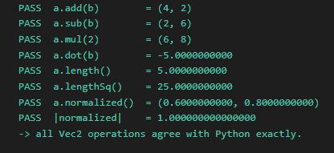
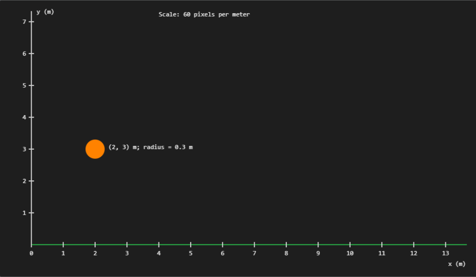
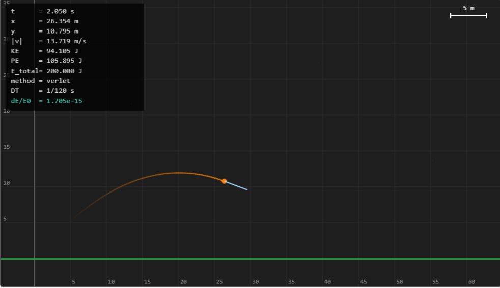
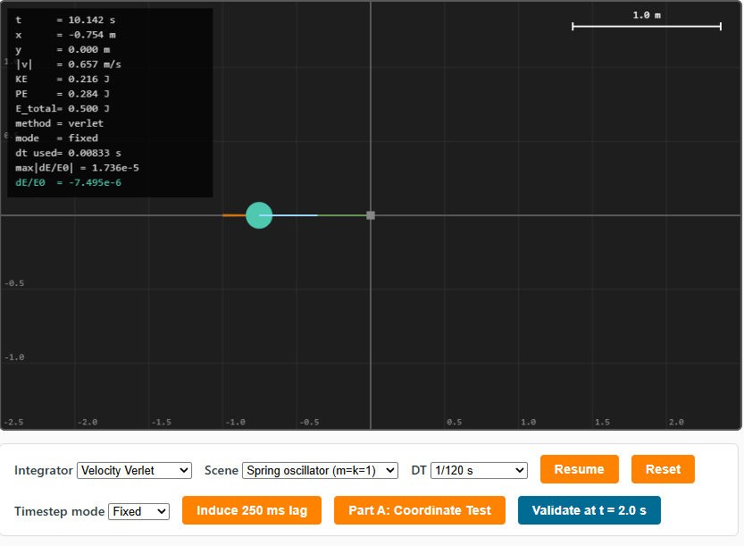
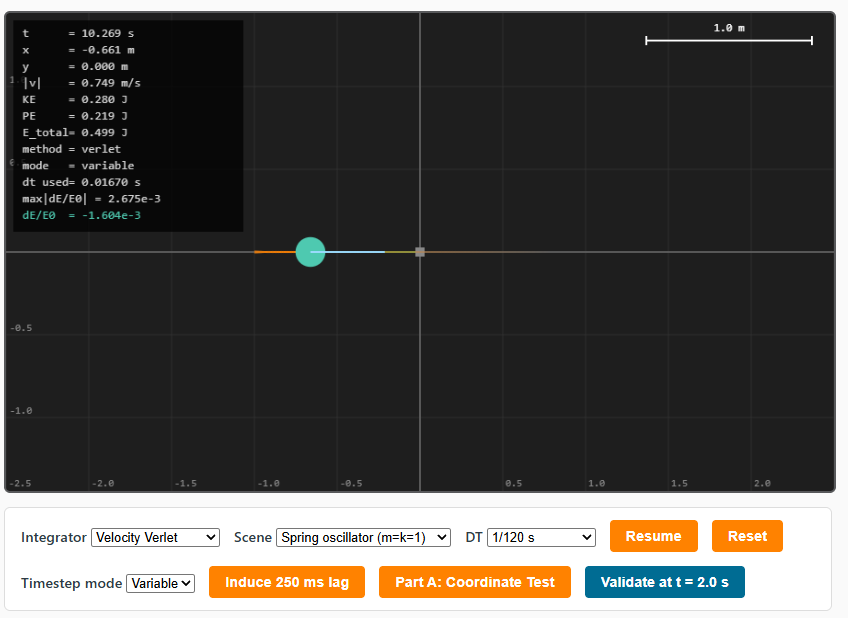
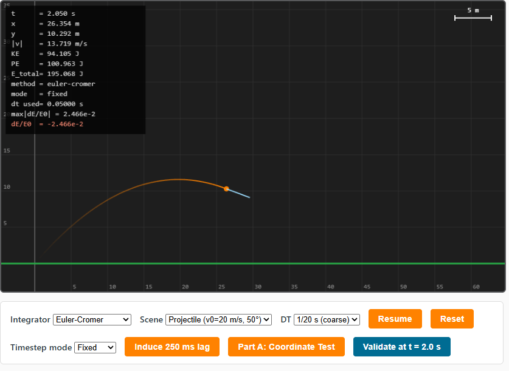
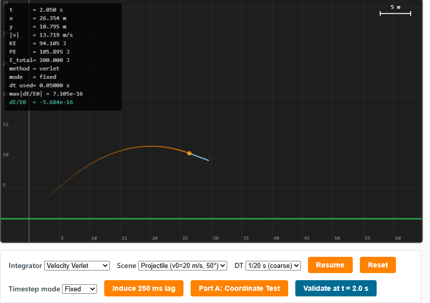

## LIVE LINK:

https://aberry46.github.io/phys311/labs/lab08/

# Lab 8: Port Your Integrator to JavaScript

Alexander S. Berry  
PHYS 311  
October 25, 2026

## Purpose

The purpose of this lab is to move the physics calculations from the Lab 7 Python engine into a browser-based JavaScript simulation. I tested vector operations and coordinate transforms, displayed projectile motion with a live energy readout, and checked whether Python and JavaScript produced the same numerical results. I also compared timestep modes and integrators to see how they affected numerical accuracy.

## Part A: Vectors and Coordinate Transform

The Vec2 self-test checked the addition, the subtraction, the scalar multiplication, the dot product, the magnitude, the squared magnitude, the normalization, and the magnitude of a normalized vector. All eight checks passed.

 For example, with a = (3, 4) and b = (1, -2), addition returned (4, 2), the dot product returned -5, and the magnitude of a was 5. These results matched the expected mathematical values.

*Figure 1. Console output showing the passing vector self-tests.*

The static scene used a scale of 60 canvas pixels per meter, with labeled ticks every meter. The circle was centered at (2, 3) m with a radius of 0.3 m, placing its center 120 canvas pixels to the right of the origin and 180 pixels above the ground. Its radius was 18 canvas pixels. The ground appeared near the bottom of the canvas, and positive y pointed upward, confirming the coordinate transform's y-flip.

*Figure 2. Static circle at (2, 3) m with labeled axes and the ground at y = 0.*

## Part B: Ported Integrator and Projectile Simulation

The simulation used a Body class containing position, velocity, acceleration, force, mass, and radius, along with methods to clear force and calculate kinetic energy. Euler-Cromer and Velocity Verlet used the same stepping interface. The fixed-timestep animation loop accumulated elapsed frame time, advanced the physics in constant steps, clamped long frame times, and rendered once per animation frame. A fading trail retained the most recent 200 physics positions.

The projectile had a mass of 1 kg and launched from ground level at 20 m/s and 50 degrees, with gravitational acceleration of 9.81 m/s². The HUD displayed time, position, speed, kinetic energy, potential energy, and total energy to three decimal places. Using Velocity Verlet at a timestep of 1/120 s, the screenshot at 2.050 s showed kinetic energy of 94.105 J and potential energy of 105.895 J. Their sum remained 200.000 J, with a relative energy change of approximately 1.705 × 10⁻¹⁵, consistent with floating-point round-off.

*Figure 3. Projectile simulation using Velocity Verlet at DT = 1/120 s.*

## Part C1: Python and JavaScript Agreement

Both simulations used the Lab 7/8 Velocity Verlet implementations, a mass of 1 kg, initial position (0, 0) m, launch speed of 20 m/s, launch angle of 50 degrees, and gravity of 9.81 m/s². Each simulation ran exactly 240 steps at DT = 1/120 s, giving 2 seconds of simulated time. The JavaScript comparison ran without rendering or browser frame timing.

| Quantity | Python (Lab 7) | JavaScript (Lab 8) | Absolute difference |
|---|---:|---:|---:|
| x (m) | 25.711504387461677 | 25.711504387461677 | 0 |
| y (m) | 11.021777724759163 | 11.021777724759163 | 0 |
| vx (m/s) | 12.855752193730787 | 12.855752193730787 | 0 |
| vy (m/s) | -4.2991111376204216 | -4.2991111376204216 | 0 |
| Total energy (J) | 200.00000000000034 | 200.00000000000034 | 0 |

Python and JavaScript produced identical final positions, velocities, and total energy at the reported precision. This confirms numerical agreement for the tested projectile case. The total energy remained approximately 200 J, with only a negligible floating-point deviation.

## Part C2: Fixed Versus Variable Timestep

The comparison used the spring oscillator with m = 1 kg, k = 1 N/m, initial displacement of 1 m, and initial velocity of zero. Both runs used Velocity Verlet and the same 0.25 s frame-time clamp. Fixed mode used DT = 1/120 s, while variable mode stepped directly with the measured, clamped frame duration. The lag button deliberately blocked the browser for 250 ms. The screenshots record the largest absolute relative energy error reached since Reset.

| Mode | Screenshot time (s) | Maximum absolute relative energy error | Maximum percentage error |
|---|---:|---:|---:|
| Fixed | 10.142 | 1.736 × 10⁻⁵ | 0.001736% |
| Variable | 10.269 | 2.675 × 10⁻³ | 0.2675% |

*Figure 4. Fixed-timestep spring oscillator after the lag test.*

*Figure 5. Variable-timestep spring oscillator after the lag test.*

The spring oscillator continued moving along the horizontal axis in both modes, but variable timesteps produced a much larger energy error during the lag test. The maximum relative energy error was 0.001736% with fixed timesteps and 0.2675% with variable timesteps, approximately 154 times larger. The fixed-step accumulator handled delayed frames using multiple small physics steps, while variable mode used a single larger step. Constant timesteps support Verlet's usual bounded long-term energy-error behavior; changing step sizes and introducing large steps can worsen that behavior. The screenshots were taken at slightly different simulation times, so the difference in their positions alone does not demonstrate trajectory error.

## Part C3: Integrator Comparison

Both projectile runs used fixed timesteps of 1/20 s and the same launch conditions as Part B. Both screenshots were taken at 2.050 s, allowing a direct comparison.

| Quantity at 2.050 s | Euler-Cromer | Velocity Verlet |
|---|---:|---:|
| x (m) | 26.354 | 26.354 |
| y (m) | 10.292 | 10.795 |
| Speed (m/s) | 13.719 | 13.719 |
| Kinetic energy (J) | 94.105 | 94.105 |
| Potential energy (J) | 100.963 | 105.895 |
| Total energy (J) | 195.068 | 200.000 |
| Relative energy change | -2.466 × 10⁻² | -5.684 × 10⁻¹⁶ |

*Figure 6. Euler-Cromer at DT = 1/20 s.*

*Figure 7. Velocity Verlet at DT = 1/20 s.*

At a timestep of 0.050 s, Euler-Cromer's total energy decreased from 200 J to 195.068 J after 2.050 s, while Velocity Verlet maintained 200.000 J to the displayed precision. Projectile motion is a weak general test because constant gravity gives both methods identical velocity updates, and Verlet reproduces the exact trajectory apart from round-off. A spring oscillator is a stronger test because its acceleration changes with position, making differences in energy behavior more apparent over repeated oscillations.

## Reflection: Hardest Part to Port

In my experience, the hardest part was connecting the physics calculations to the browser's animation loop and controls. In Python, I could have simply ran a fixed number of steps directly, but browser frames have variable timing. Therefore, I needed an accumulator to keep the physics timestep consistent. I also encountered a blank canvas after removing the Reset button while the JavaScript still expected it, demonstrating how a small interface change could stop the program before the animation began. In comparing my Python and JavaScript results, I found the verification successful and truly helpful for understanding how to properly diagnose issues. 
