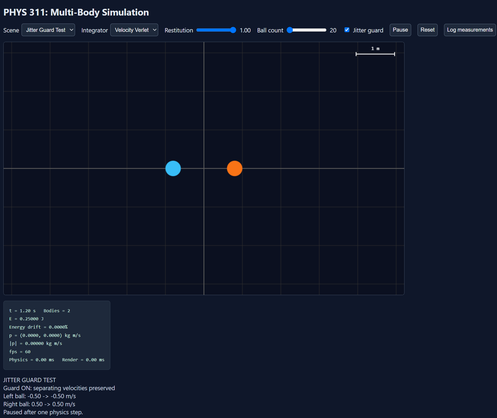
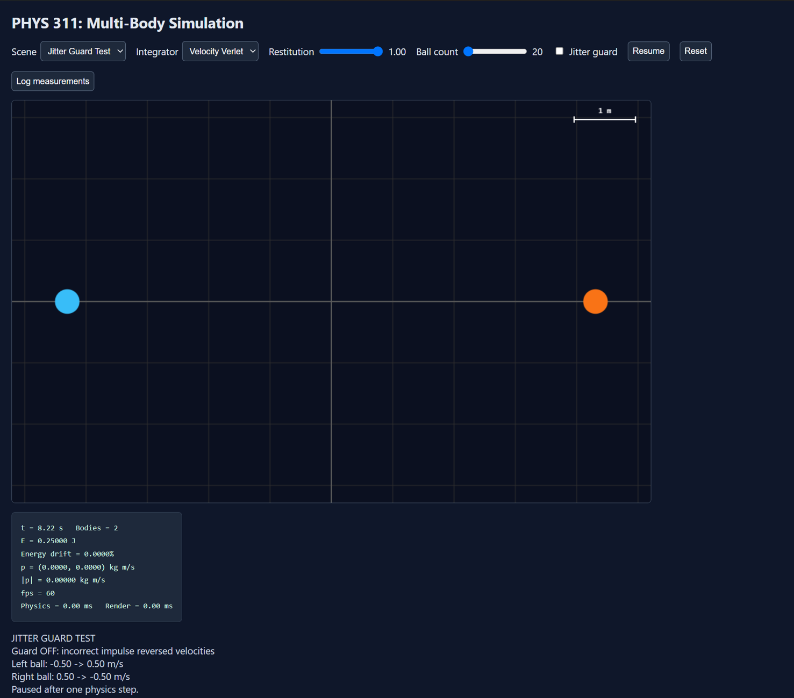
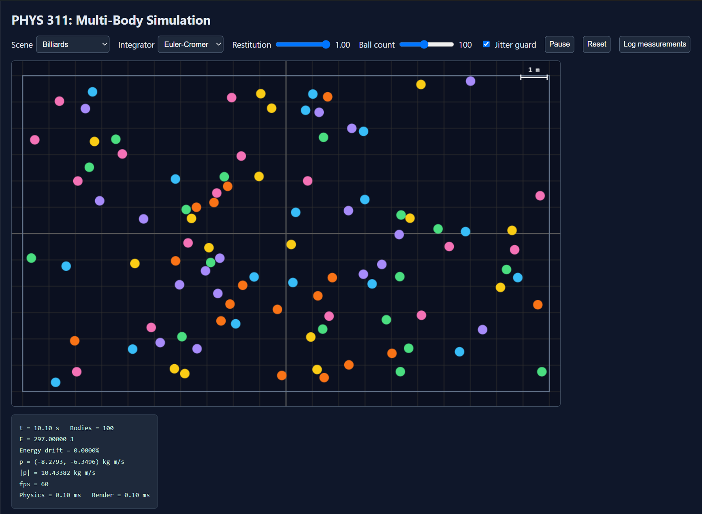
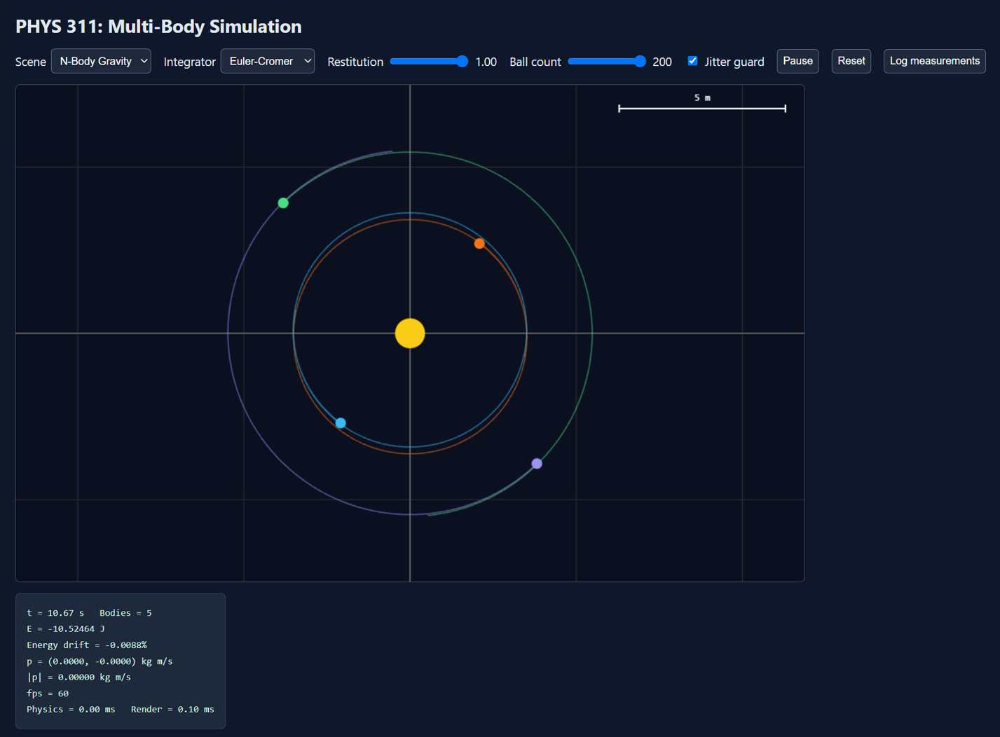
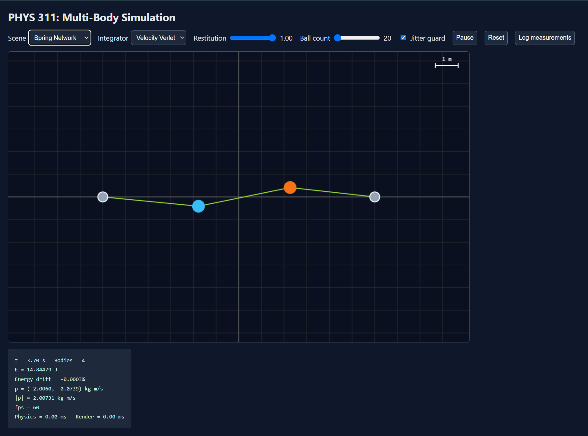

# PHYS 311: Lab 9
## Multi-Body Browser Simulation

## Part A: Modular Engine

### A1. Module Structure

The JavaScript engine was organized into separate modules for bodies, forces, integrators, collisions, and world management. As intended, the rendering and HUD functions were kept separate from the physics engine.

**Module Dependency Diagram**

```text
                   main.js
                      |
             +--------+--------+
             |                 |
           engine/           render/
             |                 |
          world.js         renderer.js
             |               hud.js
     +-------+-------+
     |       |       |
   body.js forces.js integrators.js
     |       |       |
     +--- collisions.js
              |
           vec2.js
```

### A2. Engine Implementation

The `World` class follows five steps:

1. Clear forces.
2. Apply forces.
3. Integrate motion.
4. Resolve collisions.
5. Advance time.

The engine cleanly supports gravity, drag, Newtonian gravity, and spring forces. Both Euler-Cromer and Velocity Verlet are available, using a fixed timestep of 1/240 s.

**Part A Analysis**

Using the modular design allowed for the same engine to run three different simulations without changing the core physics structure. Separating the physics and rendering additionally made the code easier to organize.

---

## Part B: Collisions and Conservation

### B1. Jitter Guard Test





| Velocity (m/s) | Guard ON | Guard OFF |
|---|---:|---:|
| Left ball (final) | -0.50 | +0.50 |
| Right ball (final) | +0.50 | -0.50 |
| Total energy (J) | 0.25000 | 0.25000 |

**Analysis**

With the jitter guard enabled, both balls continued separating normally. Disabling the guard causes an unnecessary collision impulse to occur that ultimately reverses their velocities. Energy remains conserved, which demonstrates that conservation laws alone do not guarantee correct collision behavior.

### B2. Elastic Collisions

The 20-body billiards simulation was tested with restitution e = 1.00.

| Measurement | Initial | Final |
|---|---:|---:|
| Time (s) | 0.00 | 60.02 |
| Energy (J) | 59.40000 | 59.40000 |
| Energy drift (%) | 0.0000 | ~0.0000 |

**Analysis**

The total kinetic energy remained constant throughout the simulation, which is consistent with elastic collisions. Momentum changed because the surrounding walls introduced external impulses.

### B3. Isolated Momentum Test

Wall collisions were disabled to test momentum conservation without external wall impulses.

| Measurement | Initial | Final |
|---|---:|---:|
| Time (s) | 0.42 | 60.07 |
| Energy (J) | 59.40000 | 59.40000 |
| Px (kg m/s) | -0.2410 | -0.2410 |
| Py (kg m/s) | 3.4550 | 3.4550 |

**Analysis**

Both momentum components remained constant to the displayed precision over 60 seconds. Energy also remained unchanged, consistent with conservation laws for an isolated system.

### B4. Inelastic Collisions

The simulation was repeated with restitution e = 0.80.

| Time (s) | Energy (J) | Drift (%) |
|---:|---:|---:|
| 0.00 | 59.40000 | 0.0000 |
| 9.13 | 25.58962 | -56.9198 |
| 16.63 | 15.45805 | -73.9764 |
| 21.00 | 13.90816 | -76.5856 |
| 25.88 | 10.75983 | -81.8858 |
| 30.72 | 8.71252 | -85.3325 |

**Analysis**

Kinetic energy decreased at every recorded measurement, consistent with inelastic collisions. Unlike elastic collisions, some kinetic energy is lost during each impact. Momentum remains conserved during isolated ball-to-ball collisions.

---

## Part C: Three Simulation Scenes

### C1. Billiards



The billiards scene demonstrated wall and ball-to-ball collisions with adjustable restitution. Elastic collisions maintained kinetic energy, while inelastic collisions caused energy loss.

### C2. Gravitational N-Body



| Measurement | Result |
|---|---:|
| Bodies | 5 |
| Time (s) | 60.32 |
| Total energy (J) | -10.52370 |
| Energy drift (%) | +0.0001 |
| FPS | 60 |

**Analysis**

The gravitational simulation maintained stable orbital motion over 60 seconds using Velocity Verlet. The extremely small energy drift indicates good numerical stability, with no bodies escaping or producing numerical errors.

### C3. Spring Network



The spring network contained four bodies, including two fixed anchors and two moving masses.

At 3.90 seconds, the total energy was 14.84478 J with an energy drift of -0.0004%.

**Analysis**

The spring network demonstrated oscillatory motion using the same physics engine. The small energy drift was consistent with approximately conserved mechanical energy.

### C4. Performance Scaling

| Bodies | Physics (ms) | Render (ms) | FPS |
|---:|---:|---:|---:|
| 20 | 0.00 | 0.10 | 60 |
| 50 | 0.00 | 0.10 | 60 |
| 100 | 0.10 | 0.10 | 60 |
| 200 | 0.30 | 0.10 | 60 |

**Analysis**

The simulation maintained 60 FPS for all tested body counts. Physics computation time increased with the number of bodies, consistent with the expected O(n²) collision-checking complexity. The largest tested configuration sustaining 60 FPS was 200 bodies. A spatial grid could improve performance by reducing unnecessary collision checks.

### C5. Engine Reusability

All three required scenes used the same underlying engine, with different bodies, forces, and initial conditions. No scene-specific physics engine changes were needed.

---

## Conclusion

Overall, Lab 9 successfully extended the previous Python and JavaScript work into a modular multi-body browser simulation. The conservation tests demonstrated correct elastic and inelastic collision behavior, while the gravitational and spring simulations showed the engine's flexibility. In full summary, the project demonstrated the importance of modular architectures!