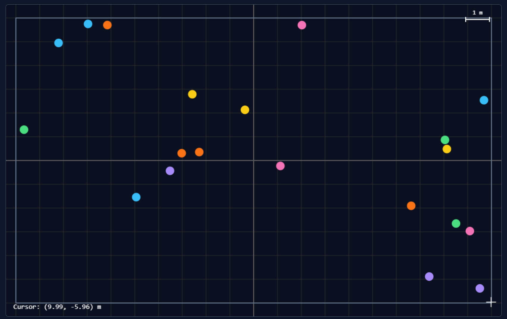

# PHYS 311: Lab 10 - Interactive Simulation

## Overview

This lab expanded the existing JavaScript physics engine into an interactive simulation. The project includes user-controlled parameters, body manipulation, physics visualizations, and conservation diagnostics. The objective was to make the simulation accessible and allow users to explore different physical behaviors directly.

---

## Part A: Input and Control Panel

### A1. Coordinate-Correct Input

Pointer coordinates were converted from browser coordinates into physics coordinates using the canvas dimensions and camera transformations. A crosshair and live coordinate display were implemented to verify the conversion.

In the Billiards scene, the bottom-right boundary produced a reading of approximately (9.99, -5.96) m, closely matching the expected (10, -6) m boundary.

### A2. Simulation Controls

The simulation includes pause/resume, single-step, reset, speed adjustment, and integrator selection.

Single-step advances the simulation by exactly one fixed timestep:

\[
\Delta t = \frac{1}{240} \approx 0.004167 \text{ s}
\]

Simulation speed is adjusted through the accumulator rather than changing the timestep. This preserves consistency in the numerical integration.

The available integration methods are Euler, Euler-Cromer, and Velocity Verlet.

### A3. Parameter Sliders

Three sliders directly modify the physics:

- Restitution: 0 to 1
- Gravitational strength: 0.1 to 2.0
- Spring stiffness: 1 to 40 N/m

These parameters update during the simulation without requiring a reset.

#### Numerical Stability

The spring stiffness was limited to 40 N/m to reduce the possibility of numerical instability.

The approximate stability condition for a simple spring-mass oscillator is:

\[
\Delta t < 2\sqrt{\frac{m}{k}}
\]

Using m = 1 kg and k = 40 N/m:

\[
\Delta t < 0.316 \text{ s}
\]

The simulation uses a fixed timestep of approximately 0.004167 s, which is substantially smaller than this limit. Although the full spring network contains multiple oscillation modes, the chosen range provides a reasonable operating range and was tested at its maximum value.

---

## Part B: Direct Manipulation and Visual Physics

### B1. Body Manipulation

Two interactions were implemented in the Billiards scene.

**Grab and Drag:** Existing bodies can be moved using a damped spring force directed toward the pointer. This allows the bodies to continue interacting with collisions and retain physical velocity when released.

**Slingshot Launch:** Users can drag backward from an empty location to launch a new body. A trajectory preview shows the predicted initial motion before release.

#### Teleport-Dragging Analysis

Teleport-dragging directly changes a body's position without applying a physical force. This creates two problems. First, the body can move through boundaries or other objects without correctly resolving collisions. Second, its velocity becomes inconsistent with its displacement, making energy and momentum calculations unreliable.

The damped spring method instead accelerates the body through an applied force, preserving the normal physics calculations and producing a more realistic release velocity.

### B2. Physics Visualizations

Three independently toggleable visualizations were implemented.

**Motion Trails:** Trails display the paths followed by moving bodies, making changes in direction and orbital motion easier to observe.

**Velocity Vectors:** Arrows represent the direction and relative magnitude of velocity, making changes in motion during collisions more apparent.

**Energy Graph:** A live graph tracks total mechanical energy over time, helping users observe energy conservation and energy losses during inelastic collisions.

### B3. Responsiveness and Accessibility

The interface uses labeled HTML controls, keyboard shortcuts, and canvas fallback text. The canvas was updated to resize with the browser window while accounting for device pixel ratio.

Pause, reset, speed, integrator selection, and parameter sliders can be operated using standard keyboard controls.

The simulation also supports pointer events for mouse and touch interactions and checks for reduced-motion preferences.

The keyboard-only test confirmed that the simulation's buttons, sliders, dropdown menus, and visualization toggles could be operated using Tab, Enter, Space, and the arrow keys. The playback shortcuts also worked as intended. Direct body manipulation still requires pointer input, which remains an accessibility limitation.

---

## Part C: Interactive Physics Experience

### C1. Project Purpose

The final project is an interactive multi-body physics sandbox designed to demonstrate how forces, collisions, and numerical integration affect motion.

Users can explore four scenes:

1. Billiards
2. Jitter Guard Test
3. N-Body Gravity
4. Spring Network

The simulation includes conservation diagnostics and interactive controls that allow users to investigate physical behavior.

### C2. Physics Concepts and Validation

The project incorporates concepts from previous labs, including numerical integration, momentum and energy conservation, collisions, gravitational forces, and Hooke's law.

#### Energy Conservation Test

The Billiards scene was tested for 60 seconds using Velocity Verlet integration and perfectly elastic collisions.

| Parameter | Result |
|---|---:|
| Scene | Billiards |
| Integrator | Velocity Verlet |
| Restitution | 1.00 |
| Simulation time | 60.0000 s |
| Initial energy | 59.400000 J |
| Final energy | 59.400000 J |
| Relative energy difference | 0.000000% |
| Final momentum magnitude | Approximately 23.937 kg m/s |

The initial and final mechanical energies agreed to six decimal places, indicating excellent energy conservation for the tested configuration.

The system's total momentum was not expected to remain constant because collisions with the boundaries introduce external impulses on the bodies.

Overall, the results support the accuracy of the collision and integration methods under these conditions.

### C3. Robustness Testing

The simulation was tested under demanding conditions, including maximum slider values, rapid body dragging, repeated slingshot launches, frequent resetting, and browser resizing.

Throughout these tests, the simulation continued operating without observed errors, frozen frames, or invalid numerical values.

These results suggest that the implementation is stable under the tested conditions.

---

## Conclusion

Lab 10 successfully expanded the previous physics engine into an interactive simulation. The addition of direct manipulation, adjustable parameters, and physics visualizations made it possible to explore how different forces and numerical methods affect motion.

The conservation test demonstrated excellent agreement between initial and final energy, while robustness testing showed that the simulation remained functional under demanding interactions. Overall, the project provides a foundation for further development into a more focused interactive physics application.
